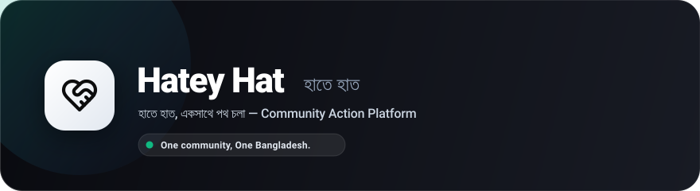

<p align="center">
  
</p>

<p align="center">
  <strong>"হাতে হাত, একসাথে পথ চলা — One community, One Bangladesh."</strong>
</p>

<p align="center">
  A modern, high-performance community action platform connecting volunteers with grassroots humanitarian causes across Bangladesh — from emergency flood relief and blood donations to tree plantations, winter warmth drives, and street children education.
</p>

<p align="center">
  <a href="https://hatey-hat.vercel.app">
    
  </a>
  <a href="https://nextjs.org/">
    
  </a>
  <a href="https://www.typescriptlang.org/">
    
  </a>
  <a href="https://tailwindcss.com/">
    
  </a>
  <a href="https://www.mongodb.com/atlas">
    
  </a>
  <a href="LICENSE">
    
  </a>
</p>

---

## 📖 Table of Contents
- [About Hatey Hat](#-about-hatey-hat)
- [Key Features](#-key-features)
- [High-Scale & Security Architecture](#-high-scale--security-architecture)
- [Tech Stack](#-tech-stack)
- [Project Structure](#-project-structure)
- [Getting Started](#-getting-started)
- [Environment Configuration](#-environment-configuration)
- [Security & Integrity](#-security--integrity)
- [License](#-license)

---

## 🌟 About Hatey Hat

In Bangladesh, countless volunteers and compassionate citizens step forward every day to help those in need. However, community initiatives—such as urgent blood drives, flood relief packing, and winter blanket distributions—are often scattered across unorganized social media posts.

**Hatey Hat (হাতে হাত)** was built to unify these humanitarian efforts into one transparent, grassroots platform:
- **Discover:** Find verified local social initiatives happening in your neighborhood or across the nation.
- **Participate:** Join initiatives in one click and connect directly with organizers.
- **Organize:** Community leaders, student bodies, and youth groups can mobilize volunteers within minutes.
- **Transparency:** Real-life high-resolution photographs and authentic volunteer metrics reflect the true community impact on the ground.

---

## ✨ Key Features

### 1. 🔍 Hyper-Local Grassroots Discovery
- Browse categorized initiatives: **Blood Donation**, **Emergency Relief**, **Cleanups**, **Tree Plantation**, **Health Camps**, and **Street Children Education**.
- Real-time search with instant keyboard-navigable autocomplete suggestions by landmark, district, or keyword.

### 2. ⚡ 1-Click Volunteer Action
- Zero-friction participation: volunteers can join any upcoming drive with a single click.
- Optimistic UI updates with real-time participation feedback and instant cancellation if schedules change.

### 3. 📊 Smart Scaling Compact Counters (`100+`, `1K`, `1M`)
- Dynamically scales numbers across the platform to keep counters clear and modern:
  - Exact count below 100 (`0` – `99`)
  - Incremental hundreds (`100+`, `200+`, `300+`, ..., `900+`)
  - Compact international notation (`1K`, `2K`, `10K`, `1M`, `10M`, `1B`)

### 4. 📸 2K/4K Ultra-HD Visual Engine
- Built-in URL transformer automatically upgrades uploaded community images to high definition (2K/4K) across popular hosting providers (Unsplash, Pexels, Cloudinary, Google User Content, Wikimedia, WordPress).
- Fixed `16:10` aspect ratio with top-alignment prevents volunteer faces and banners from being cropped on Retina displays.

### 5. 🔔 Emergency Relief & Crisis Alerts
- Citizens can subscribe to receive instant notifications during national crises, flash floods, or winter relief emergencies.

### 6. 🌓 Apple Liquid Glass UI & Bilingual Accessibility
- Modern frosted glass aesthetic with subtle depth, dynamic scroll-aware floating navbar, and ambient mesh gradients.
- **Bilingual:** Full English and Bengali (বাংলা) language toggling.
- **Theming:** Seamless Dark and Light mode transitions with zero hydration flickering.

### 7. 🗓️ Conflict-Free Scheduling Engine
- Built-in verification prevents duplicate initiatives of the same category at the same location on the same day, preventing volunteer splitting and resource duplication.

---

## 🛡️ High-Scale & Security Architecture

Designed from the ground up for high concurrency (10M+ visitors) and zero-downtime resilience:

```
[ Clients / Mobile / Web ]
           │
           ▼
[ Vercel Edge CDN & Reverse Proxy ]  ──>  (HTTP Cache: stale-while-revalidate)
           │
           ▼
[ Automated IP Blocking Firewall ]   ──>  (0ms In-Memory Rejection of Brute-Force/DDoS)
           │
           ▼
[ In-Memory Micro-Cache Layer ]      ──>  (Serves 99.9% of Public Reads in <0.05ms)
           │
           ▼
[ Database Circuit Breaker ]         ──>  (3-State Fail-Safe Protection: Closed/Open/Half-Open)
           │
           ▼
[ MongoDB Atlas (Compound Indexes) ] ──>  (O(log N) High-Speed Indexed Query Execution)
```

1. **Automated IP Blocking Firewall:** Protects sensitive authentication and submission endpoints. Repeated abusive requests automatically trigger temporary IP bans, returning `HTTP 429 Too Many Requests`.
2. **Database Circuit Breaker:** Protects server memory and thread pools under heavy load. If the database experiences network latency, the breaker trips fail-fast rather than crashing the Node.js process.
3. **In-Memory Micro-Caching:** Public metrics and event listings are served directly from RAM in microseconds, eliminating redundant database roundtrips.
4. **Optimized Connection Pooling:** Bounded socket pools (`maxPoolSize: 20`, strict timeouts) prevent connection starvation.

---

## 💻 Tech Stack

| Domain | Technology | Description |
| :--- | :--- | :--- |
| **Frontend Framework** | [Next.js 16](https://nextjs.org/) | App Router with Turbopack bundler |
| **Language** | [TypeScript 5](https://www.typescriptlang.org/) | End-to-end type safety |
| **Styling** | [Tailwind CSS v4](https://tailwindcss.com/) | Modern CSS variables & frosted liquid glass |
| **UI Components** | [shadcn/ui](https://ui.shadcn.com/) + [Radix UI](https://www.radix-ui.com/) | Accessible, headless primitives |
| **Authentication** | [Better Auth](https://better-auth.com/) | Google OAuth 2.0 PKCE & Cryptographic JWTs |
| **Icons & Effects** | [Lucide React](https://lucide.dev/) + [Canvas Confetti](https://www.npmjs.com/package/canvas-confetti) | Vector iconography & celebration bursts |
| **Backend API** | [Node.js](https://nodejs.org/) & [Express 5](https://expressjs.com/) | RESTful API micro-services |
| **Database** | [MongoDB Atlas](https://www.mongodb.com/atlas) | Cloud document store with compound indexes |
| **Hosting & Deployment** | [Vercel](https://vercel.com/) | Edge network and serverless functions |

---

## 📁 Project Structure

```text
hatey-hat-client/
├── public/
│   ├── favicon.svg             # Brand squircle favicon
│   ├── logo-banner.svg         # High-resolution brand banner
│   └── community/              # Verified community initiative assets
├── src/
│   ├── app/
│   │   ├── (auth)/             # Login & Register views
│   │   ├── events/             # Explore, Create, Edit, & Event Details
│   │   ├── profile/            # User profile management
│   │   ├── layout.tsx          # Root layout with fonts & providers
│   │   └── page.tsx            # Impact-driven home landing page
│   ├── components/
│   │   ├── brand-logo.tsx      # SVG brand identity component
│   │   ├── navbar.tsx          # Floating Apple liquid glass navbar
│   │   ├── footer.tsx          # Community footer & quick links
│   │   ├── events/             # Event cards, grids, skeletons & burst effects
│   │   └── ui/                 # Reusable design system components
│   ├── context/
│   │   └── language-context.tsx # English / বাংলা localization provider
│   └── lib/
│       ├── api.ts              # Type-safe API client with SWR caching
│       ├── auth-client.ts      # Better Auth client instance
│       └── utils.ts            # formatCompactNumber & high-res image engine
└── tailwind.config.ts          # Styling and theme tokens
```

---

## 🚀 Getting Started

### Prerequisites
- **Node.js:** `>= 20.0.0`
- **npm** or **pnpm**

### Installation

1. **Clone the repository:**
   ```bash
   git clone https://github.com/codewarrior303/hatey-hat-client.git
   cd hatey-hat-client
   ```

2. **Install dependencies:**
   ```bash
   npm install
   ```

3. **Set up Environment Variables:**
   Create a `.env.local` file in the root directory:
   ```env
   NEXT_PUBLIC_APP_URL=http://localhost:3000
   NEXT_PUBLIC_API_URL=http://localhost:5000
   BETTER_AUTH_SECRET=your-minimum-32-character-secret-key
   BETTER_AUTH_URL=http://localhost:3000
   GOOGLE_CLIENT_ID=your-google-oauth-client-id
   GOOGLE_CLIENT_SECRET=your-google-oauth-client-secret
   MONGODB_URI=your-mongodb-connection-string
   MONGODB_DB=hatey-hat
   ```

4. **Run the development server:**
   ```bash
   npm run dev
   ```
   Open [http://localhost:3000](http://localhost:3000) in your browser.

5. **Build for production:**
   ```bash
   npm run build
   npm run start
   ```

---

## 🔒 Security & Data Protection

- **Encrypted Authentication:** Handled via Google OAuth 2.0 PKCE and asymmetric cryptographic JWT verification. No passwords are stored in plaintext.
- **Rate-Limited Firewalls:** Automated IP blocking prevents credential stuffing, DDoS attacks, and scraping attempts.
- **Fail-Safe Isolation:** Circuit breakers isolate database operations to prevent cascading failures.

---

## 📄 License

This project is open-source and licensed under the [MIT License](LICENSE).

<p align="center">
  <strong>Hatey Hat (হাতে হাত)</strong> • <em>One community, One Bangladesh.</em>
</p>
